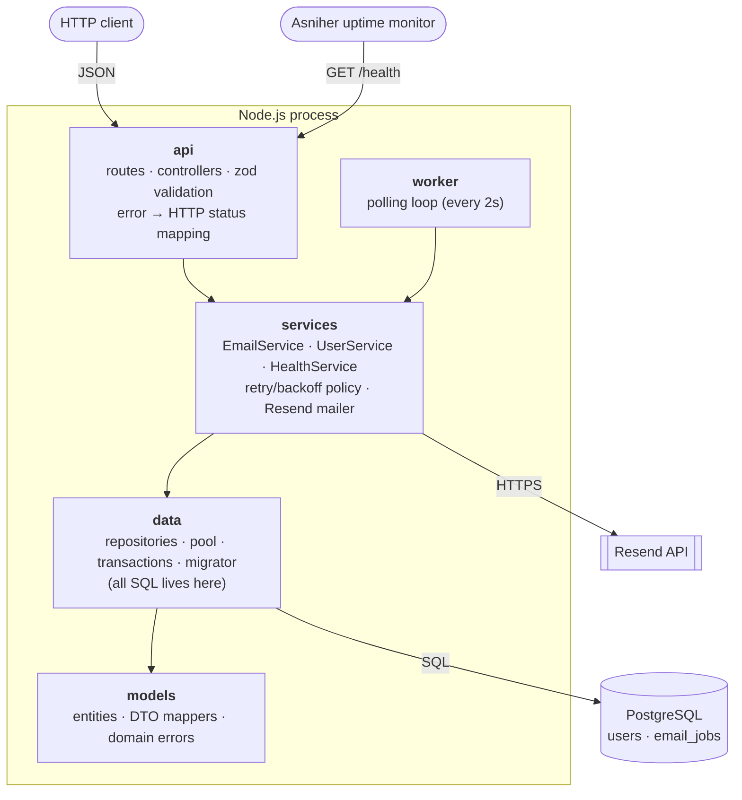
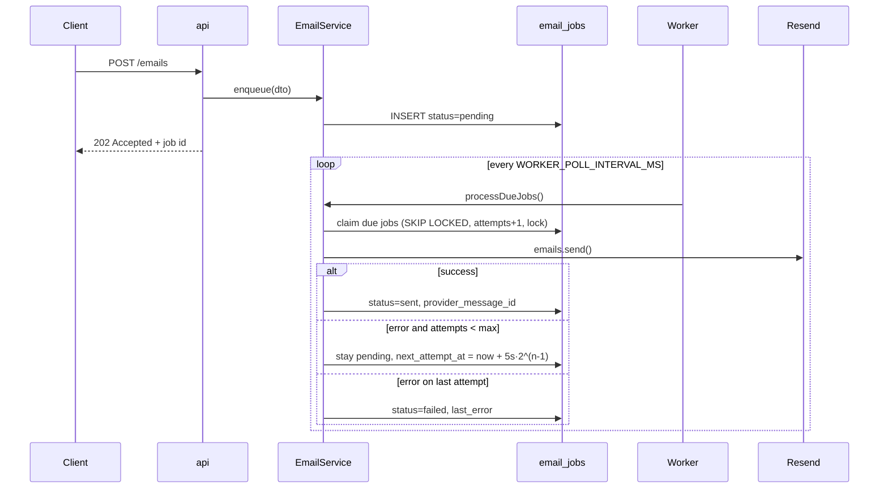

# Mail Queue API

A small monolithic Node.js backend that **queues emails in PostgreSQL** and delivers them through
**[Resend](https://resend.com)** using a background worker. Failed sends are retried with exponential backoff.
The app exposes a `/health` endpoint, which an uptime monitor checks in production.

- **Stack:** Node.js 22, Express 5, PostgreSQL, `pg`, Resend SDK, zod (validation), pino (structured logs)
- **Queue:** a Postgres table polled with `SELECT … FOR UPDATE SKIP LOCKED`, so no Redis is needed and several workers can run safely
- **Live URL:** `https://<your-app>.onrender.com` <!-- replace after deploying -->

---

## Architecture



| Layer | Folder | Responsibility | May import |
|---|---|---|---|
| **api** | `src/api` | Routes, controllers, request validation, HTTP status codes and response shapes. | `models` (DTO mappers, error types) |
| **services** | `src/services` | Business logic: enqueueing, retry policy, the Resend integration, templates, transactions across repositories. | `models` |
| **data** | `src/data` | The connection pool, repositories, migrations. **The only place SQL appears.** | `models` |
| **models** | `src/models` | Plain entities/DTO definitions and domain errors. No dependencies. | nothing |

Each layer is built as a factory, and its dependencies are injected by the composition root
([`src/container.js`](src/container.js)). Controllers receive services, and services receive
repositories, so a layer only ever *calls* the layer directly below it. `models` holds plain data
types that every layer may reference.

**The layering is enforced by a test.** [`test/architecture.test.js`](test/architecture.test.js)
scans the import graph and fails if:
- a layer imports a layer it shouldn't,
- SQL appears outside `src/data`,
- `req`/`res` appear outside `src/api`.

The **worker** (`src/worker`) is a second entrypoint beside the api. It holds only the polling loop
and calls `emailService.processDueJobs()`.

### Email flow



**Retry policy:** `EMAIL_MAX_ATTEMPTS=4` (1 attempt plus **3 retries**), with backoff of 5s → 10s → 20s.
- **Crash safety:** a claimed job carries a `locked_until` lease. If a worker dies mid-send, the lease
  expires and another poll picks the job up again.
- **Abandoned jobs:** if the worker dies on a job's last attempt, the job is marked `failed`.
- **Delivery guarantee:** at-least-once.
- **Manual retry:** `POST /emails/:id/retry` re-queues a `failed` job.

`POST /users` shows why the queue matters. The user row and the welcome-email job are written in
**one transaction**, so the user exists only if the email is queued. Resend is never called on the
request path.

### Project layout

```
src/
  api/          app.js, routes/, controllers/, validators/, middleware/
  services/     emailService, userService, healthService, mail/ (Resend + dev log mailer), templates/
  data/         db.js (pool + transactions), repositories/, migrator.js
  models/       emailJob, user, errors
  worker/       emailWorker.js (poll loop)
  container.js  composition root (wires the layers)
  server.js     entrypoint: HTTP server + in-process worker
  worker.js     entrypoint: standalone worker
db/migrations/  numbered SQL migrations (tracked in schema_migrations)
db/seeds/       seed.sql (idempotent demo data)
scripts/        migrate.js, seed.js
test/           architecture, service and HTTP tests
```

---

## Setup

### Prerequisites
- Node.js **22+**
- PostgreSQL 13+ (local install, or `docker compose up db`)
- A Resend API key (optional locally; see below)

### Run locally

```bash
git clone https://github.com/<you>/mail-queue-api.git
cd mail-queue-api
npm install
cp .env.example .env          # then edit DATABASE_URL / RESEND_API_KEY

npm run migrate               # create tables
npm run seed                  # optional demo data
npm run dev                   # API + worker on http://localhost:3000
npm test                      # unit, HTTP and architecture tests
```

To run everything in Docker instead: `docker compose up --build`. This starts Postgres, runs the
migrations and starts the app.

> **No Resend key?** Outside production the app falls back to a *log mailer*. It writes each email to
> stdout and marks the job `sent`, so you can exercise the whole queue offline. In
> `NODE_ENV=production` a missing `RESEND_API_KEY` is a startup error.
>
> **Testing with Resend:** until you verify a domain, send from `onboarding@resend.dev` to the
> address you signed up with, or to Resend's test inboxes (`delivered@resend.dev`, `bounced@resend.dev`).

### Environment variables

| Variable | Default | Description |
|---|---|---|
| `NODE_ENV` | `development` | `production` requires `RESEND_API_KEY` |
| `PORT` | `3000` | HTTP port |
| `LOG_LEVEL` | `info` | pino log level |
| `DATABASE_URL` | – | Postgres connection string (takes precedence over `PG*`) |
| `PGHOST` / `PGPORT` / `PGUSER` / `PGPASSWORD` / `PGDATABASE` | – / `5432` | Used when `DATABASE_URL` is not set |
| `PGSSL` | `false` | `true` for managed DBs that require TLS |
| `PG_POOL_MAX` | `10` | Max pool connections |
| `RESEND_API_KEY` | – | Resend API key (**never commit it**) |
| `EMAIL_FROM` | `Mail Queue <onboarding@resend.dev>` | Sender address |
| `WORKER_ENABLED` | `true` | Run the worker inside the web process |
| `WORKER_POLL_INTERVAL_MS` | `2000` | Queue polling interval |
| `WORKER_BATCH_SIZE` | `10` | Jobs claimed per poll |
| `EMAIL_MAX_ATTEMPTS` | `4` | Total attempts (1 + 3 retries) |
| `EMAIL_RETRY_BASE_DELAY_MS` | `5000` | Backoff base: `base · 2^(attempt-1)` |
| `EMAIL_LOCK_TIMEOUT_MS` | `60000` | Lease on a claimed job before another worker may take it |

See [`.env.example`](.env.example).

### Database

- **Migrations:** `npm run migrate` applies every file in `db/migrations/*.sql` that hasn't run yet.
  - Files run in filename order, each in its own transaction.
  - Applied files are recorded in `schema_migrations`.
  - A Postgres advisory lock stops two deploys from migrating at the same time.
- **Seed:** `npm run seed` loads 3 users and 3 email jobs (2 `sent`, 1 `failed`). It is idempotent.
  The seeded jobs are already in a final state, so the worker won't send them. To watch a retry,
  call `POST /emails/aaaaaaaa-0000-4000-8000-000000000003/retry`.

---

## API

All responses are JSON. Errors look like `{"error": {"code": "...", "message": "...", "details"?: [...]}}`.

| Method | Path | Description |
|---|---|---|
| `GET` | `/health` | App + DB status. `200` healthy, `503` if the DB is unreachable |
| `POST` | `/emails` | Queue an email → `202 Accepted` |
| `GET` | `/emails?status=&limit=&offset=` | List jobs (newest first) |
| `GET` | `/emails/stats` | Job counts per status |
| `GET` | `/emails/:id` | Job status, attempts, last error |
| `POST` | `/emails/:id/retry` | Re-queue a `failed` job → `202` (`409` if not failed) |
| `POST` | `/users` | Create a user + queue a welcome email (one transaction) → `201` |
| `GET` | `/users/:id` | Get a user |

### Example requests

**Health check**
```bash
curl -i http://localhost:3000/health
```
```json
HTTP/1.1 200 OK
{
  "status": "ok",
  "app": { "status": "up", "name": "mail-queue-api", "version": "1.0.0", "environment": "production", "uptimeSeconds": 5321 },
  "database": { "status": "up", "latencyMs": 2 },
  "timestamp": "2026-11-03T12:14:55.310Z"
}
```
When the database is down:
```json
HTTP/1.1 503 Service Unavailable
{ "status": "error", "app": { "status": "up", ... }, "database": { "status": "down", "error": "Database unreachable" }, ... }
```

**Queue an email**
```bash
curl -X POST http://localhost:3000/emails \
  -H "Content-Type: application/json" \
  -d '{"to":"delivered@resend.dev","subject":"Hello","html":"<p>Hi from the queue!</p>"}'
```
```json
HTTP/1.1 202 Accepted
Location: /emails/caa847c0-ac58-4e2d-8489-d5fffe8619ef
{
  "data": {
    "id": "caa847c0-ac58-4e2d-8489-d5fffe8619ef",
    "to": "delivered@resend.dev",
    "subject": "Hello",
    "status": "pending",
    "attempts": 0,
    "maxAttempts": 4,
    "lastError": null,
    "providerMessageId": null,
    "nextAttemptAt": "2026-11-03T12:14:55.396Z",
    ...
  }
}
```

**Check its status**
```bash
curl http://localhost:3000/emails/caa847c0-ac58-4e2d-8489-d5fffe8619ef
```
```json
{ "data": { "id": "caa847c0-...", "status": "sent", "attempts": 1, "providerMessageId": "4ef9a417-02e9-4d39-ad75-9611e0fcc33c", "sentAt": "2026-11-03T12:14:56.102Z", ... } }
```
A job that exhausted its retries:
```json
{ "data": { "status": "failed", "attempts": 4, "maxAttempts": 4, "lastError": "Resend error (validation_error): API key is invalid", ... } }
```

**List failed jobs and retry one**
```bash
curl "http://localhost:3000/emails?status=failed&limit=10"
curl -X POST http://localhost:3000/emails/caa847c0-ac58-4e2d-8489-d5fffe8619ef/retry
curl http://localhost:3000/emails/stats      # {"data":{"pending":0,"sent":12,"failed":1}}
```

**Register a user (queues a welcome email)**
```bash
curl -X POST http://localhost:3000/users \
  -H "Content-Type: application/json" \
  -d '{"email":"linus@example.com","name":"Linus"}'
```
```json
HTTP/1.1 201 Created
{ "data": { "user": { "id": "65d710e8-...", "email": "linus@example.com", "name": "Linus", ... },
            "welcomeEmail": { "id": "c46d082a-...", "subject": "Welcome, Linus!", "status": "pending", ... } } }
```

**Validation error**
```bash
curl -X POST http://localhost:3000/emails -H "Content-Type: application/json" -d '{"to":"nope","subject":""}'
```
```json
HTTP/1.1 400 Bad Request
{ "error": { "code": "validation_error", "message": "Invalid request",
  "details": [ { "location": "body", "field": "to", "message": "Invalid email address" }, ... ] } }
```

---

## Deployment

The repo includes a [Render Blueprint](render.yaml), which provisions a free Postgres database and
the web service:

1. Push the repo to GitHub.
2. In Render, go to **New → Blueprint** and select the repo.
3. Enter `RESEND_API_KEY` when prompted.
4. On each deploy Render runs `npm run migrate && npm start`. It also uses `/health` as its own health check.
5. Optional: run the seed once from the service **Shell** with `npm run seed`.

The [`Dockerfile`](Dockerfile) works on any container host (Railway, Fly.io, a VPS). Set the env vars
above; the container migrates on start.

> To scale delivery separately from the API, set `WORKER_ENABLED=false` on the web service. Then run
> `npm run worker` as a separate background worker. `SKIP LOCKED` keeps several workers from sending the same job.

## Monitoring (Asniher)

An Asniher HTTP monitor checks the deployed `GET /health` endpoint:

- **URL:** `https://<your-app>.onrender.com/health`
- **Expected status:** `200` (any other status, including `503` when the DB is down, raises an alert)
- **Check interval:** 1 minute
- **Optional:** keyword check that the body contains `"status":"ok"`


The app logs successful `/health` requests at `silent` level, so a one-minute check doesn't flood
the logs. Failures are still logged as errors.
